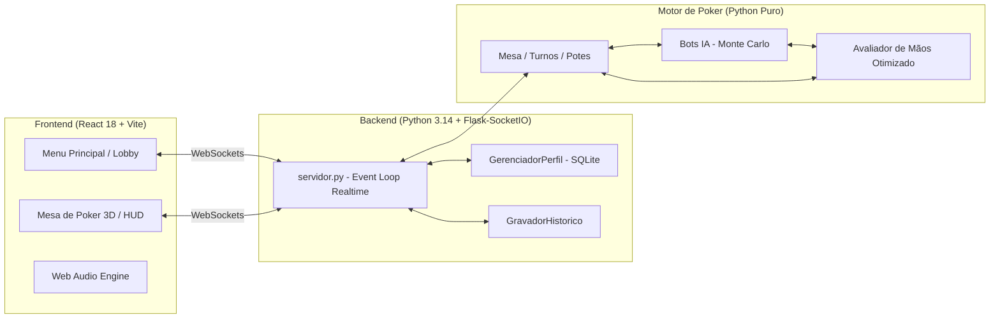

# Simulador de Poker Texas Hold'em em Python + React 🃏

[](https://www.python.org/)
[](https://react.dev/)
[](https://vitejs.dev/)
[](https://socket.io/)
[](https://www.sqlite.org/)
[](#-testes-automatizados)
[](#)

Um simulador completo e profissional de **Texas Hold'em No-Limit**, integrando motor matemático de alta performance em Python, inteligência artificial autônoma (Bots com Monte Carlo), backend em tempo real com WebSockets e uma interface moderna e imersiva em React com física de cartas e fichas.

> ⚠️ **Aviso Educacional:** Este é um projeto de código aberto desenvolvido estritamente para fins acadêmicos, de estudo de inteligência artificial e de desenvolvimento de software. Não envolve apostas com dinheiro real (*Play Money Only*).

---

## ✨ Principais Funcionalidades

### 🏛️ Lobby VIP & Menu Principal
- **Seleção de Stakes:** Mesas de Cash Game dinâmicas (Micro $5/$10, Médio $10/$20, High $25/$50 e VIP High Roller $50/$100).
- **Setup de Buy-In Flexível:** Slider interativo e presets rápidos para escolher a entrada entre 10 e 1.000 Big Blinds.
- **Perfil e Economia Persistente:** Saldo inicial de $100.000 gerenciado em SQLite com conservação estrita de fichas (`Saldo_Final = Saldo_Anterior - BuyIns + Stack_Mesa`).
- **Hub de Estatísticas:** Acompanhamento ao vivo de métricas do jogador (VPIP, PFR, Agressividade, Taxa de Vitórias e Arquétipo de estilo).
- **Exportação de Histórico:** Download direto com um clique do arquivo de histórico compatível com PokerStars (`/api/historico-txt`).

### ♠️ Mesa de Jogo & Modo Espectador
- **Física Visual com Framer Motion:** Distribuição direcional de cartas (*dealing*), flip 3D suave das cartas comunitárias (*Flop*, *Turn*, *River*) e física dinâmica de pilhas de fichas deslizando até o vencedor do pote.
- **Modo Espectador & Botão `↑ Levantar`:** O jogador pode se levantar da mesa a qualquer momento (com fold seguro mid-hand se houver rodada em andamento) para assistir a partida.
- **Assento Livre Interativo:** A vaga vazia na mesa exibe um card com seta pulsante (`⬇ Sentar`), permitindo retornar à partida com novo buy-in quando desejar.
- **Rebuy Pós-Showdown:** Sistema inteligente de recompra com delay estratégico após o encerramento do River/Showdown, permitindo que o usuário veja as cartas dos oponentes antes do modal abrir. Recusar o rebuy retorna diretamente ao Menu Principal.

### 🤖 Inteligência Artificial & Dinâmica dos Bots
- **Cérebro Matemático com Monte Carlo:** Bots inteligentes que calculam equidade e pot odds em tempo real utilizando o `AvaliadorDeMaosOtimizado`.
- **Tempos de Resposta Humanizados:** Distribuição calibrada e centralizada (`CONFIG_TEMPOS`) para gameplay dinâmica (83% entre 1-3s, 10% entre 3-6s, 2% tankando e 5% ações instantâneas).
- **Segurança contra Timeout:** Timer regressivo com barra visual de 10s que força auto-check ou auto-fold se o usuário não responder a tempo.

### 🔊 Áudio de Cassino Procedural (Web Audio API)
- Efeitos sonoros sintetizados nativamente no navegador, sem arquivos externos pesados: barulho de fichas apostadas, cartas sendo distribuídas, batidas de mesa (check), folds e comemoração de pote ganho.
- Controle global de mudo persistente entre telas.

---

## 🏗️ Arquitetura do Sistema



---

## 📁 Estrutura de Pastas

```text
poker/
├── Python/
│   ├── core/                        # Motor de Poker puro e regras do jogo
│   │   ├── avaliador_otimizado.py   # Algoritmo bitwise de avaliação rápida
│   │   ├── bot.py                   # Cérebro de IA dos bots (Monte Carlo)
│   │   ├── mesa.py                  # Lógica de rodadas, potes e turnos
│   │   ├── jogador.py               # Entidade do jogador, stacks e espectador
│   │   ├── perfil.py                # Gerenciador de perfil e saldo SQLite
│   │   └── gravador_historico.py    # Formatador de Hand History (PokerStars)
│   ├── frontend/                    # Aplicação Web React
│   │   ├── src/
│   │   │   ├── components/          # MenuPrincipal.jsx, Mesa.jsx, etc.
│   │   │   ├── audioEngine.js       # Síntese procedural de sons via Web Audio
│   │   │   ├── App.jsx              # Conexão Socket.IO e chaveamento de telas
│   │   │   └── index.css            # Estilização moderna e layout da mesa
│   │   └── package.json             # Dependências (Vite, React, Framer Motion)
│   ├── tests/                       # Suíte unificada de testes automatizados
│   │   ├── test_perfil.py           # Testes de bankroll e saldo atômico
│   │   ├── test_servidor_rotas.py   # Testes de integração de endpoints e sockets
│   │   ├── test_bordas.py           # Cenários de limite (espectador, buy-in)
│   │   ├── test_caotico.py          # Estresse de apostas e all-ins múltiplos
│   │   └── test_historico.py        # Validação do parser de Hand History
│   ├── docs/                        # Documentação técnica e planejamento
│   │   ├── tempos_e_dinamica_de_jogo.md
│   │   ├── roadmap.md
│   │   └── otimizacao_avaliador.md
│   ├── youtube/                     # Produção de conteúdo para o canal
│   │   ├── roteiros/                # Roteiros detalhados e checklists de gravação
│   │   └── Thumbs/                  # Thumbnails dos episódios do Devlog
│   ├── servidor.py                  # Servidor WebSocket (Flask-SocketIO)
│   ├── main.py                      # Ponto de entrada legado para terminal
│   └── CHANGELOG.md                 # Registro cronológico detalhado de mudanças
```

---

## 🚀 Como Executar o Projeto

### Pré-requisitos
- **Python 3.10+** (recomendado Python 3.12+)
- **Node.js 18+** e **npm**

### 1. Inicializar o Backend (Python)

No terminal, acesse a pasta `Python` e instale as dependências (se ainda não tiver instalado):

```bash
cd Python
pip install flask flask-cors flask-socketio
```

Em seguida, inicie o servidor:

```bash
python servidor.py
```

O servidor iniciará em `http://localhost:5000` gerenciando as conexões WebSocket e o banco SQLite.

---

### 2. Inicializar o Frontend (React + Vite)

Em um segundo terminal, acesse a pasta `Python/frontend`:

```bash
cd Python/frontend
npm install
npm run dev
```

Abra o seu navegador em `http://localhost:5173`. O Lobby VIP será carregado instantaneamente!

---

## 🧪 Testes Automatizados

O projeto conta com uma rigorosa suíte de testes unitários e de integração que garantem a integridade matemática do jogo e a conservação de fichas. Para executar todos os testes:

```bash
cd Python
python -m unittest tests/test_perfil.py tests/test_servidor_rotas.py tests/test_historico.py tests/test_caotico.py tests/test_bordas.py
```

*Resultado esperado: **Ran 24 tests ... OK***

---

## 📜 Histórico de Atualizações

Para o histórico completo e detalhado de cada versão e arquivo modificado, consulte o arquivo [`CHANGELOG.md`](CHANGELOG.md).

- **Novembro/2026**: Implementação do Modo Espectador (`↑ Levantar` e vaga livre `⬇ Sentar`), unificação do fluxo de Bankroll persistente ($100k inicial com conservação estrita), calibração acelerada dos tempos dos bots (`CONFIG_TEMPOS`) e suíte completa de testes de borda.
- **Outubro/2026**: Criação do Lobby VIP em React, sistema de áudio procedural (Web Audio API), gravação e download de Hand History em formato PokerStars, e integração de física visual com Framer Motion.
- **Setembro/2026**: Implementação de algoritmos *Single-Pass* e *Bitwise* para avaliação ultra-rápida de mãos, atingindo mais de 200.000 avaliações por segundo. Criação de arquitetura híbrida de desempate e reorganização modular da estrutura de diretórios do projeto.
- **Maio/2024**: Implementação robusta dos algoritmos de desempate de pares e identificação das 5 melhores cartas de um jogador na mesa.

```text
[poker_python: Programa de simular Poker, a ideia é fazer todas classes que representam cartas,
baralho, jogadores, mesa, etc. Fazer funções que identificam qual a classificação da mão do jogador
para aquela rodada, quais são as 5 combinações de cartas do jogador que resulta na melhor mão naquela
rodada, desempate de jogadores, entre muitas outras coisas que irei desenvolvendo que eu achar interessante.

Dia 27/04/2024: Consegui realizar completamente o desempate do par, ou seja, agora ele consegue indicar certinho quais jogadores ganharam aquela rodada a partir de um empate de várias pessoas com um par. Agora é desenvolver o desempate para cada uma das mãos existentes e depois lembrar de pensar em como fazer para imprimir sempre ao lado da mensagem dos vencedores, qual foi a combinação de cinco cartas que resultou na melhor mão da rodada, depois disso tudo, lembrar de otimizar e 
modularizar tudo. Também realizei muitos comentários explicativos do passo a passo do desempate de pares]
```

```